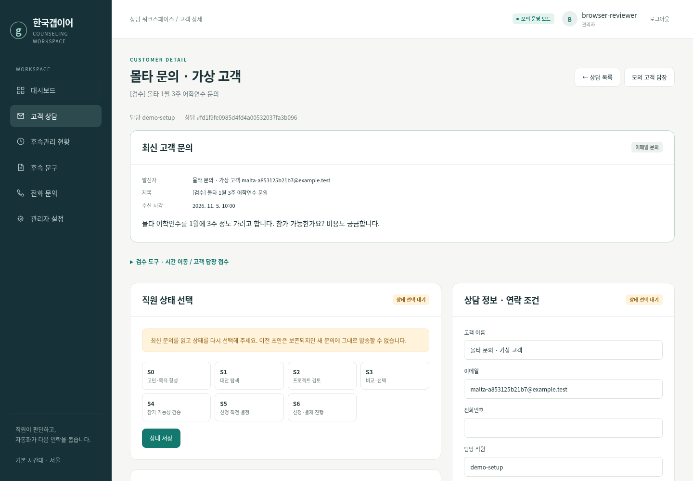
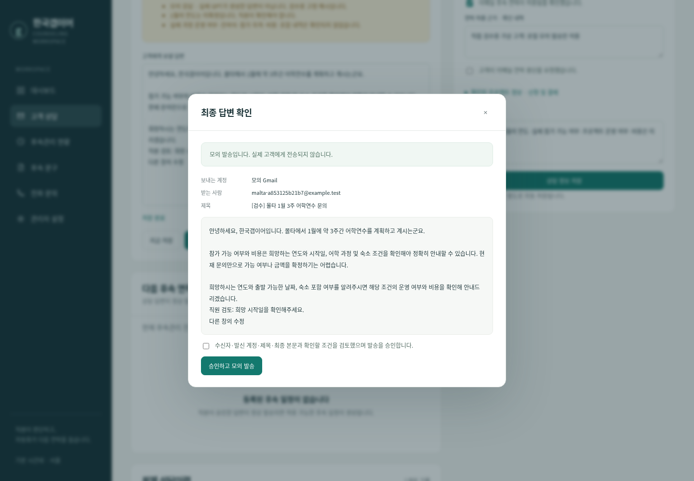

# 사용성 개선·실제 연동 준비 결과 — 2026-11-05

> 이 문서는 이전 사용성 개선 작업의 기록입니다. 이후 화면 간소화·Render 준비·제한 운영 변경과 현재 비용·인증 대기는 [최신 실제 배포·연동 진행표](LIVE_ROLLOUT.md)를 기준으로 확인하세요. 아래 테스트 수와 배포안은 당시 결과이며, 별도 도메인은 현재 Render 제한 시험의 필수 조건이 아닙니다.

기존 `review/staff-test-drive` 프로젝트를 개선했습니다. 새 프로젝트·다른 플랫폼으로 바꾸지 않았습니다.
현재 결과는 **코드 수정과 브라우저 검증 완료, 실제 배포·사용자 인증·외부 API 검증 대기**입니다.
사용자는 호스팅이 아직 없다고 답했으며, 실제 확인용 수신 주소만 지정했습니다. 이 주소로
실제 메일을 보내거나 OAuth 계정·API 키를 추측해 연결하지 않았습니다.

## 완료 상태 구분

| 구분 | 결과 |
| --- | --- |
| 코드 수정 완료 | 네 가지 사용성 문제, 초안 충돌·승인 검증, Gmail OAuth·수집 범위, OpenAI 실제 요청·사용량, 운영 상태·중지·제한 시험 구현 |
| 브라우저 검증 완료 | 격리된 모의 DB에서 실제 Chromium으로 편집·저장·새로고침·충돌·발송·예약·답장·모바일 흐름 확인 |
| 실제 외부 API 검증 완료 | **아니오.** 실제 Gmail/OpenAI 인증정보 없음. HTTP 모의 전송 검증과 구분 |
| 배포 완료 | **아니오.** 호스팅·도메인 없음. 제공할 운영 HTTPS 주소 없음 |
| 사용자 인증 또는 승인 대기 | 호스팅·도메인 준비, Google OAuth 설정과 본인 계정 승인, OpenAI 비밀키·모델 등록, 지정 수신자와 실제 시험 |
| 미구현·운영 제한 | Sheets 문구 동기화, Gmail History API 증분 수집, 외부 장애 알림·오프사이트 백업 등 아래 명시 |

## A. 사용성 수정 전후

수정 전 커밋을 별도 임시 디렉터리에서 실행하고 같은 Chromium 조작으로 네 문제를 재현했습니다.

| 항목 | 수정 전 실제 결과 | 수정 후 실제 결과 |
| --- | --- | --- |
| 답변 편집 → 상담 정보 저장 | 미저장 답변 수정분 소실 | 편집란을 유지하고 서버 자동 저장. 새로고침·다른 화면 왕복 후 동일 내용 복원 |
| 같은 S4 다시 저장 | 남은 예약 5개 모두 취소 | 예약 5개의 ID·예정일·상태 그대로 유지. 단순 정보 저장도 유지 |
| 문의 원문 위치 | 상태 선택·답변 작성 아래에 상담이력 | 상세 첫 업무 영역에 최신 문의·발신자·제목·시각 표시 |
| 대시보드 카드 | 클릭 가능한 카드 0개 | 카드 8개 모두 이동. 요청한 6종 카드의 표시 건수와 필터 목록 건수 일치 확인 |

추가로 실제 브라우저에서 확인한 내용:

- 자동 저장 요청에 의도적으로 503 오류를 반환해 저장 실패 표시와 작성 내용 보존 확인.
- 실패 중 새로고침 시 Chromium의 `beforeunload` 경고, 메뉴 이동 시 미저장 경고 확인.
- 같은 초안을 두 창에서 편집해 오래된 창의 저장이 409 충돌로 차단되고 직접 비교·병합한 경우만 저장됨.
- 답변 재생성 확인을 취소하면 기존 초안 그대로 유지.
- 최종 승인 창의 수정된 본문과 모의 Gmail outbox의 발송 본문 일치.
- 고객 답장 수신 시 해당 상담 예약 5개 취소, 상태 재선택 전 생성 차단, 같은 S4 재선택 후 새 초안 생성.
- 관리자 4개 기능 상태, 재연결 표시, 경과 예약 건별 승인, 후속 일시중지·재개 확인.
- 390px 모바일 화면 가로 넘침 없음, JavaScript 런타임 오류 없음.

아래 이미지는 사용자의 맥북 화면이 아니라 **동일 코드의 임시 모의 데이터로 촬영한 검증 화면**입니다.





## B. 외부 접속·로그인·배포

현재 확인 가능한 실행은 개발·로컬 검수이며 실제 운영 HTTPS 주소는 없습니다.
맥북과 무관한 상시 운영·다른 기기/네트워크 접속·공개 인증서 발급은 **미검증**입니다.
코드 저장소의 ZIP 주소는 웹사이트 접속 주소가 아닙니다.

준비한 구성: 단일 Linux 서버, Caddy HTTPS, systemd 자동 재시작, 단일 Uvicorn 프로세스 안의
30초 수신·예약 실행, 영속 SQLite와 비밀정보 분리 디렉터리, 일일 SQLite 백업 타이머.
서비스 설정과 실제 설치 순서는 [배포 안내](DEPLOYMENT.md)에 있습니다. 이 설정 파일 작성만으로
배포 완료라고 판단하지 않습니다. 유료 가입·결제·소스 저장소 공개 전환은 하지 않았습니다.

API 검사에서 비로그인 고객정보·발송 접근 차단, 직원의 관리자 기능 차단, CSRF·Origin 검사,
공개 파일 경로에서 DB·비밀파일 미노출을 확인했습니다. 운영 모드에서는 실제 HTTPS origin과
영속 데이터 절대 경로를 요구하고 Secure 세션 쿠키·Host 제한을 적용합니다.
공유 검수 계정은 `production_ready`가 없어 운영 로그인에 사용할 수 없습니다. 새 운영 계정
생성 또는 새 비밀번호로 운영 승격해야 하며 기존 세션을 무효화합니다. 실제 사용자 맥북의
계정이나 비밀번호를 이 작업에서 변경하지는 않았습니다.

## C. 실제 연동과 검증 대기

| 항목 | 구현·자동 검증 범위 | 실제 API 결과 |
| --- | --- | --- |
| 연결 Gmail 계정 | 관리자 OAuth, 세션 결합 state·PKCE, code 교환 뒤 실제 profile 주소 확인, 다른 계정 혼합 차단 | 연결 계정 없음 |
| 문의 수집 범위 | 전용 라벨·시작 시점·건수 미리보기 후 확정. 등록 스레드는 라벨 없이도 답장 추적 | 사용자가 범위 확정해야 함 |
| 실제 Gmail 수신 | 중복 ID 방지, 계정/스레드 구분, 자동회신·반송·회사 직접 발송 구분, 실패 시 후속 보류 | 미수행 |
| 실제 GPT 초안 | 실제 Chat Completions 호출, 모델·요청 ID·시각·사용량, 실패 시 모의 대체 금지, 일일 제한 | 미수행 |
| 직원 승인 실제 발송 | 최종 초안 버전·문의·상태·수신자·제목 검사, 스레드/메일 헤더, 중복·불명확 발송 차단 | 미수행 |
| 실제 답장 후 예약 취소 | 해당 상담 취소·초안 보존·재선택; 제한 시험에서는 실제 취소한 예약 ID 증거 필요 | 미수행 |
| 승인 문구 실제 예약 발송 | 확인용 수신자·별도 상담·예약 1건, 일반 고객 시각과 기본 간격 유지, 승인·치환·S6 조건 유지 | 미수행 |

실제 제한 시험에서는 `lim@weyear.co.kr`를 확인용 수신자로 설정할 수 있습니다. 이 주소는
**연결할 Gmail 계정으로 간주하지 않습니다**. Google 인증에서 사용자가 선택한 주소가 발신 계정입니다.
관리자가 지정한 확인용 상담 이외에는 제한 시험 중 실제로 발송하지 않습니다.
실제 수신·OpenAI 생성·직원 발송·실제 예약 취소·후속 발송 증거가 있어야 운영 전환할 수 있습니다.
현재 증거는 없으므로 운영 활성화 완료라고 보고하지 않습니다.

사용자가 어느 화면에서 무엇을 생성하고 어디에 안전하게 입력할지,
Google Testing/게시/검증의 차이와 정확한 callback 조립 규칙은
[연결 설정 및 실제 시험 순서](CONNECTION_SETTINGS.md)에 한 번에 정리했습니다.

## D. 운영 상태와 데이터 보존

- 실제 발송 활성화 범위: **없음**. 개발 DB·검수 DB 모두 `live_enabled=false` 확인.
- 개발 DB의 기존 35개 문구: 모두 승인 대기 유지. 검수 DB는 기존 S4 5개 승인·나머지 30개 대기 유지.
- 원본 Excel 내용과 운영 문구를 수정하거나 전체 승인하지 않음.
- 실제 수신 작업·예약 작업의 마지막 정상 실행 시각: 운영 서버가 없으므로 실제 운영 기록 없음.
  코드에서는 지속 저장하고 관리자 화면에 마지막 시도·성공·오류를 표시함.
- 기준 저장소: SQLite. Sheets는 SQLite → Sheets 보고 내보내기. 시트 수정은 문구에 반영되지 않음.
- 모의/실제 출처를 저장하며 과거 출처 불명 데이터도 보수적으로 모의로 두어 실제 발송 승격을 차단.
- 회사가 정보를 확인해 답해야 하는 상담은 직원 업무로 남기고 고객 무응답 후속을 시작하지 않음.
- 운영 활성화·오래된 예약 재개 시 경과 예약은 개별 검토 대기. 자동 일괄 실행하지 않음.
- 결과 불명확 발송은 재전송하지 않으며 Gmail 기록 확인 전 해당 고객의 추가 발송을 막음.
- 전체 자동 후속 중지는 관리자 버튼으로 제공. 긴급 전체 중지·재연결·복구 방법은 배포 안내에 수록.

백업·복원은 임시 DB에서 실제 실행했습니다. WAL 포함 온라인 백업, 0600 권한, 무결성 검사,
기존 세션·OAuth 임시 state 제거, 상담·문구 승인 유지, 새 디렉터리에만 복구, 복구 후 발송 중지와
상담별 후속 보류를 확인했습니다. 메일 수집 범위·AI 사용량 보조 DB도 함께 백업합니다.
실제 운영 서버의 백업 타이머 설치·외부 저장소 복제는 아직 수행하지 않았습니다.

## 자동 검증 결과

```text
.venv/bin/python -m pytest -q
126 passed, 1 warning in 17.78s
```

1개 경고는 Starlette 테스트 클라이언트의 AnyIO 별칭 폐기 예정 경고입니다. 실패·건너뜀은 없습니다.
Python/JavaScript 문법 검사, 의존성 검사, `git diff --check`를 통과했습니다.
별도 CLI 시험에서 운영 계정 초기화·비밀번호 변경·백업·복원·계정 비활성화를 임시 경로에서 실행했습니다.
브라우저 재현 코드는 `scripts/check_staff_ui.py`, `tests/browser_staff.cjs`에 보존했습니다.

이 테스트들은 외부 API 모의 전송과 임시 데이터만 사용합니다. 실제 계정의 권한·쿼터·모델 사용,
수신·발송 성공, 외부 HTTPS 접속 검증을 대체하지 않습니다.

## 남은 제한

1. 호스팅·실제 도메인·Google 본인 승인·OpenAI 비밀 설정이 필요해 배포와 실제 왕복 메일 시험 대기.
2. Sheets 문구·양방향 동기화와 Sheets 최초 OAuth 연결 UI 미구현. 기존 단방향 보고만 지원.
3. Gmail History API 증분 수집 미구현. 라벨 목록과 등록 스레드를 반복 조회하며 10,000건 초과 시 중단.
4. 장애·사용량 알림은 관리자 화면에 표시. 외부 알림 서비스·외부 가동 감시는 미구현.
5. 일일 로컬 백업 구성만 준비. 다른 서버/저장소로 암호화된 복제, 디스크 용량 알림·보관 정책은 호스팅 후 설정.
6. S6 신청·결제 시스템 자동 조회 없음. 직원이 최신 상태를 확인. 공휴일 자동 달력 연동 없음.
7. Gmail 마지막 조회 이후 도착하는 답장과 발송 사이의 원격 시간차는 남음. 절대 동시성·최종 수신/열람을 보장하지 않음.
8. SQLite는 단일 서버 로컬 디스크 운영을 전제로 함. 여러 서버·공유 파일시스템 배포는 지원하지 않음.
