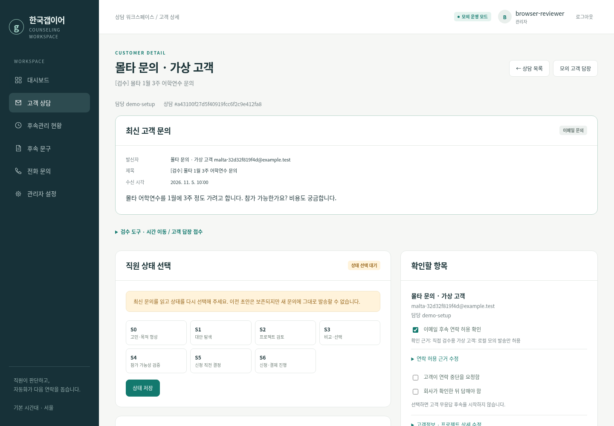
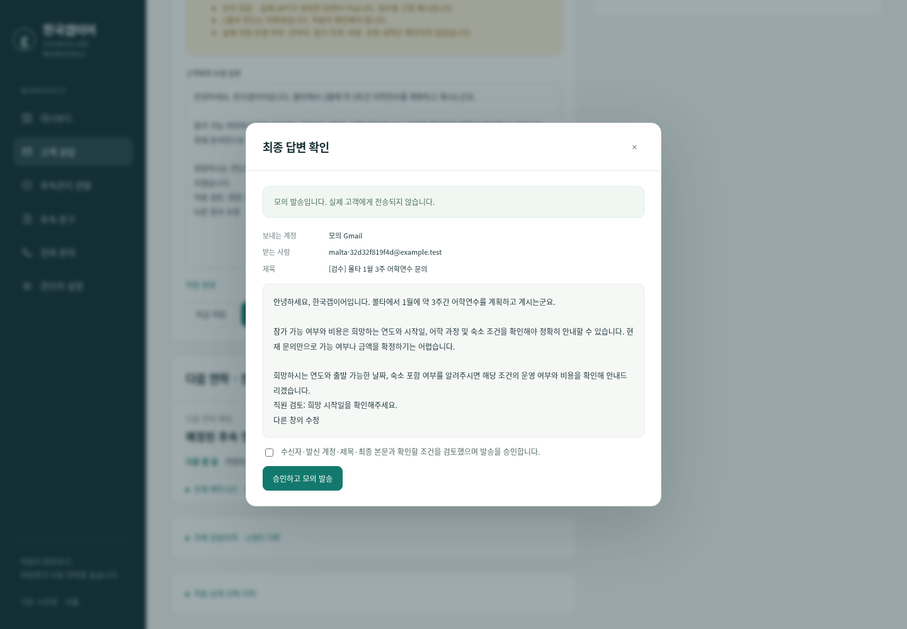

# 실제 배포·연동·제한 운영 진행표 — 2026-11-05

기존 `review/staff-test-drive` 브랜치의 코드를 이어서 수정했습니다. 기존 자동 저장·복원·충돌 감지,
같은 상태 재저장 시 예약 유지, 고객 답장 후 예약 취소, Gmail OAuth, 실제 OpenAI 어댑터와
제한된 발송 시험 기능이 코드에 있는 것을 확인했습니다. 새 프로젝트를 만들지 않았습니다.

**현재는 코드 준비와 격리 모의 검증을 마쳤으며, 실제 배포·Gmail·OpenAI 인증은 대기 중입니다.**
발급된 운영 HTTPS 주소, 연결된 Gmail 계정, 실제 GPT 생성·메일 발송 결과는 없습니다.
사용자 맥북의 사이트를 대신 접속하거나 계정을 변경한 결과가 아닙니다.

## 결과

| 항목 | 상태 | 실제 확인 결과 | 사용자가 해야 할 일 |
|---|---|---|---|
| 사이트 HTTPS 배포 | 사용자 인증·비용 승인 대기 | Render 설정 작성. 실제 서비스·주소 미생성 | 아래 1번에서 비용 확인·승인 후 생성 |
| 직원 로그인·권한 | 코드 구현 완료·외부 검증 전 | 비로그인·직원·관리자 권한, 공유 검수 계정의 운영 로그인 차단을 로컬 검증 | 개인 관리자·직원 계정 생성, 배포 주소에서 로그인 |
| 실제 Gmail 연결 | 사용자 인증·비용 승인 대기 | OAuth·실제 연결 계정 표시 코드 존재. 실제 인증 없음 | Google 웹 클라이언트 설정 후 본인이 계정 선택·승인 |
| 실제 문의 수신 | 코드 구현 완료·외부 검증 전 | 라벨·시작 시점·중복·답장 추적·오류 보류를 모의 검증 | 범위 확정 후 확인용 계정에서 실제 문의 전송 |
| 실제 OpenAI 답변 생성 | 사용자 인증·비용 승인 대기 | 실제 API 호출·오류 표시·생성 기록 구현. 실제 생성과 품질은 미확인 | 서버에 키·모델 입력 후 연결 확인과 실제 초안 검수 |
| 직원 승인 메일 발송 | 코드 구현 완료·외부 검증 전 | 최종 수정본 승인·버전 검사·지정 수신자 제한 검증 | 확인용 상담에서 승인·발송 후 수신함 도착 확인 |
| 실제 고객 답장 수신·예약 취소 | 코드 구현 완료·외부 검증 전 | 모의 답장 수신·남은 예약 취소·상태 재선택 확인 | 실제 답장을 보내 취소된 예약 ID 확인 |
| 확인용 후속 예약 발송 | 코드 구현 완료·외부 검증 전 | 확인용 상담의 별도 예약 1건, 승인·연락 조건·중복 방지 구현 | 문구 한 건 직접 검토·승인 후 짧은 시험 예약 실행 |
| 서버 재시작 후 데이터·예약 유지 | 코드 구현 완료·외부 검증 전 | 로컬 프로세스 2개로 총 61.52초 관찰. 초안·예약 유지, 모의 발송 중복 0건 | Render 재시작 후 영속 데이터와 보류된 예약 검토 |
| 자동 발송 중지·복구 | 코드 구현 완료·외부 검증 전 | 중지·건별 재개·불명확 발송 보류·백업 복원 검증. 운영 환경 미확인 | 실제 연결 후 중지 확인, 백업 복구 연습 |

“코드 구현 완료·외부 검증 전”은 실제 계정에서 성공했다는 뜻이 아닙니다.
외부 실제 검증 완료로 바꿀 항목은 아직 없습니다. 비용 승인도 아직 받지 않았습니다.

## 이번에 반영한 내용

- 문의 원문, S0~S6, 답변 편집·생성·발송, 다음 연락일과 필요한 작업을 우선 표시합니다.
  연락처 수정·이력·전체 예약·관리자 도구는 접습니다. 업무 상태는 읽기 전용으로 바꿨습니다.
  동의·연락 거부·회사 확인 대기·S6 조건과 발송 차단 사유는 계속 보입니다.
- Render 웹 인스턴스 1개에서 수신·예약 작업을 함께 실행합니다. SQLite와 토큰·백업은
  `/var/data` 영속 디스크에 분리 저장합니다. 중복 프로세스 실행을 막습니다.
- 기존 DB가 있으면 구조 변경 전에 백업하고, 실행 중에도 일일 백업을 남깁니다.
  재시작 중 기한이 지난 실제 예약은 건별 검토로 보류합니다. 보낸 메일을 다시 예약하지 않습니다.
- 실제 연결 확인을 통과한 뒤에만 최대 5건을 관리자가 개별 제한 운영에 등록합니다.
  자동 후속은 상담마다 별도로 허용하며 답장·상태 변경 시 다시 확인합니다.
- 확인 단계에서는 지정한 확인용 상담, 제한 운영에서는 등록된 상담만 실제 OpenAI 입력으로 사용합니다.
  같은 고객의 다른 미등록 상담 내용도 이력으로 섞지 않습니다. 발송 활성화와 초안 생성 가능 여부는 구분합니다.

운영 문구 내용·승인 상태와 기본 S0~S6 일정을 변경하지 않았습니다. 모의 데이터를 운영 대상으로 전환하지 않았습니다.

아래는 이 코드의 임시 모의 데이터로 검증한 화면입니다. 사용자 맥북이나 배포 사이트를 촬영한 것이 아닙니다.

## 비용 확인: 지금 진행할 단계

우선 후보는 **Hobby 워크스페이스 + Starter 웹 서비스 1개 + 영속 디스크 1GB**입니다.
사용자가 복사한 `5 GB of bandwidth included`는 전송량입니다. SQLite 디스크 5GB가 무료라는 뜻이 아닙니다.
`Pro $25/mo + compute`, `Scale $499/mo + compute`는 워크스페이스 요금에 서버 요금이 추가된다는 뜻입니다.
이 사이트의 직원 계정 수와 Render 관리 좌석 수는 별개이며, 현재 구현에 Pro 조직 관리 기능은 필수가 아닙니다.

현재 이 개발 환경에서 Render 공식 가격 페이지 접근은 네트워크 정책으로 차단되어 있습니다.
**Starter 인스턴스와 디스크의 현재 공식 단가는 확인되지 않았으므로 월 고정 총액은 미확정**입니다.
기억에 있는 과거 가격을 사용하지 않습니다. 별도 사용량 비용은 OpenAI API, 포함량 초과 트래픽,
선택한 외부 백업 등이며 실제 조건은 신청 화면에서 확인합니다. 세금도 별도 확인합니다.

무료 구성으로 바꿔 영속 저장이나 지속적인 예약 실행을 포기한 상태를 운영 완료로 보고하지 않습니다.
이번 저장소에는 유료 리소스를 정의하는 파일만 있으며 서비스 신청·가입·결제는 수행하지 않았습니다.

## 사용자가 직접 할 작업

### 1. Render 구성 확인과 비용 승인

| 필드 | 작업 |
|---|---|
| 작업명 | 호스팅 계정·웹 서버·디스크 비용 확인 |
| 어느 화면에 들어가는가 | [Render Dashboard](https://dashboard.render.com/) → New → Blueprint |
| 무엇을 생성하거나 선택하는가 | 본인 계정으로 로그인하고 GitHub의 `SeoulPigeon/Customer_Reply_Automation`, `review/staff-test-drive` 브랜치 선택. 신청 전 리소스·비용 검토 화면까지만 확인 |
| 프로그램의 어느 설정란에 입력하는가 | 저장소의 `render.yaml`을 읽도록 선택. 웹 Starter 1개, 디스크 `/var/data` 1GB, 자동 배포 꺼짐 확인 |
| 성공하면 무엇이 표시되는가 | 신청 예정 웹 서비스와 디스크, 요금·청구 조건. **Apply/Create 전** 현재 월 서버 비용·디스크 비용 확인 |
| 비용 또는 관리자 승인이 필요한가 | 계정 가입은 본인이 진행. 유료 생성은 사용자의 비용 승인 필요. Pro/Scale 업그레이드 불필요. 아직 승인·생성하지 않음 |

비용 검토 화면에 디스크 단가가 없다면 그 화면의 공식 디스크 가격 안내를 확인합니다.
결제·인증정보를 공유하지 않고 서비스 종류와 금액·통화만 전달하면 됩니다.
승인 후 생성하여 **Live** 상태와 Render가 실제 발급한 HTTPS 주소를 확인합니다.
외부 네트워크에서도 로그인 화면을 열어 본 뒤에만 HTTPS 배포 완료로 기록합니다.
상세 설치·시작 명령·모든 경로는 [Render 배포 안내](RENDER_DEPLOYMENT.md)에 있습니다.

### 2. 개인 관리자·직원 계정

| 필드 | 작업 |
|---|---|
| 작업명 | 운영 계정 생성 |
| 어느 화면에 들어가는가 | 생성한 Render 웹 서비스 → Shell |
| 무엇을 생성하거나 선택하는가 | 개인 관리자와 직원별 새 계정. 대화에 공유한 비밀번호 재사용 금지 |
| 프로그램의 어느 설정란에 입력하는가 | `python -m app.cli create-user --username YOUR_PERSONAL_ADMIN_ID --role admin` 실행 후 비밀번호 프롬프트. 직원은 `--role staff` |
| 성공하면 무엇이 표시되는가 | 직원 계정 생성 메시지, 실제 HTTPS 사이트에서 로그인 성공. 직원은 관리자 설정 변경 불가 |
| 비용 또는 관리자 승인이 필요한가 | Render 관리 권한 필요. 직원 사이트 계정 추가 자체에 Render 유료 좌석을 구매하지 않음 |

### 3. Google 인증 설정

| 필드 | 작업 |
|---|---|
| 작업명 | Gmail API와 OAuth 웹 클라이언트 |
| 어느 화면에 들어가는가 | Google Cloud Console → 프로젝트 → Gmail API 사용 설정 → Google Auth Platform |
| 무엇을 생성하거나 선택하는가 | Branding/Audience/Data Access 설정, Clients에서 Web application 생성. 개인 Gmail이면 External로 설정하고 Testing 단계의 연결 계정을 테스트 사용자로 등록 |
| 프로그램의 어느 설정란에 입력하는가 | 사이트 관리자에 표시되는 정확한 인증 복귀 주소를 Google Authorized redirect URIs에 등록. Render Environment에 `GOOGLE_CLIENT_ID`, `GOOGLE_CLIENT_SECRET` 입력 후 재배포 |
| 성공하면 무엇이 표시되는가 | 사이트의 Gmail 연결에서 Google 계정·권한 선택 화면이 열림. 이 단계만으로 수집 성공은 아님 |
| 비용 또는 관리자 승인이 필요한가 | Google 프로젝트 설정 권한과 계정 소유자 동의 필요. 장기 운영 검증·도메인 소유 확인·보안 평가 요건은 Google 앱의 실제 조건에 따라 별도 확인 |

복귀 주소는 **실제로 발급된 HTTPS 주소 + `/api/connections/gmail/callback`**입니다.
요청 권한은 `gmail.readonly`(원문·최신 답장 조회), `gmail.send`(승인된 답장·후속 전송)입니다.
앱 자체에서 라벨·시작 시점으로 범위를 제한하지만 Google OAuth 권한 자체가 라벨 단위인 것은 아닙니다.
External/Testing은 테스트 사용자와 토큰 수명 제한이 있고 Gmail 범위의 갱신 토큰은 일반적으로 7일입니다.
Production 게시와 Google 검증 완료는 다릅니다. 단기 확인 후 장기 운영 조건을 별도로 확인합니다.

### 4. Gmail 계정 연결과 수집 범위

| 필드 | 작업 |
|---|---|
| 작업명 | 발신 계정 선택·고객 문의 라벨과 시작 시점 확정 |
| 어느 화면에 들어가는가 | 사이트 관리자 → Gmail 연결·수집 범위, Gmail 라벨 설정 |
| 무엇을 생성하거나 선택하는가 | 본인이 Google 인증 화면에서 연결 계정 선택·승인. 업무 전용 라벨과 수집 시작 시점 지정 |
| 프로그램의 어느 설정란에 입력하는가 | 라벨·시작 시점 입력 → 범위와 건수 먼저 확인 → 확인한 범위 적용. 토큰은 앱이 `/var/data/secrets/gmail-token.json`에 저장 |
| 성공하면 무엇이 표시되는가 | 실제 연결 이메일 주소, 선택 범위, 최근 수신 성공 시각. 실패하면 오류·재연결 필요 표시 |
| 비용 또는 관리자 승인이 필요한가 | 사이트 관리자와 Gmail 계정 소유자의 OAuth 승인 필요. Google 비밀번호·토큰을 채팅에 입력하지 않음 |

`lim@weyear.co.kr`는 확인용 **수신자**입니다. 연결할 Gmail 계정·발신자로 임의 설정하지 않습니다.
인증 만료 시 자동 갱신하고 회수·갱신 실패 시 재연결합니다. 조회 오류 시 자동 후속은 보류합니다.

### 5. OpenAI 연결

| 필드 | 작업 |
|---|---|
| 작업명 | 실제 API 키·모델 등록 및 생성 확인 |
| 어느 화면에 들어가는가 | OpenAI Platform → 본인 Project → API keys, Billing/Limits; Render 서비스 → Environment |
| 무엇을 생성하거나 선택하는가 | 해당 프로젝트의 API 키, 실제 접근 가능한 Chat Completions·JSON 응답 지원 모델 ID |
| 프로그램의 어느 설정란에 입력하는가 | Render에 `GAPYEAR_OPENAI_API_KEY`, `OPENAI_MODEL` 입력 후 재배포. 사이트 관리자 → 실제 요청으로 연결 검증 |
| 성공하면 무엇이 표시되는가 | 실제 생성 성공·모델·요청 식별값·사용량. 실패하면 오류 표시, 모의 답변으로 대체하지 않음 |
| 비용 또는 관리자 승인이 필요한가 | OpenAI 프로젝트 권한과 API 사용 비용 승인 필요. 연결 확인도 소량 API 비용 발생. 키는 Render 비밀 설정에만 입력 |

이 연결 성공은 상담 답변 품질 검수와 별개입니다. 아래 실제 문의의 초안까지 확인해야 합니다.

### 6. 지정 수신자에게 한 흐름 확인

| 필드 | 작업 |
|---|---|
| 작업명 | Gmail 수신 → S4 → 실제 GPT → 승인 전송 → 답장·예약 연결 확인 |
| 어느 화면에 들어가는가 | 사이트 관리자 운영·발송 설정, 상담 상세, 확인용 계정의 실제 받은편지함 |
| 무엇을 생성하거나 선택하는가 | 지정 수신자 연결 검증 단계와 `lim@weyear.co.kr`. 그 계정에서 연결된 Gmail로 몰타 문의 전송, 사이트에서 확인용 상담으로 지정 |
| 프로그램의 어느 설정란에 입력하는가 | S4 선택 → 실제 초안 생성 → 직원 검수·수정 → 제한 발송 활성화 → 최종 승인·발송. 시험 문구 1건을 직접 검토·승인한 후 확인용 예약 생성 |
| 성공하면 무엇이 표시되는가 | 실제 수신·생성·Gmail 수락 기록, 예약 ID와 취소/발송 상태. 받은편지함 도착은 확인용 계정 사용자가 별도 확인 |
| 비용 또는 관리자 승인이 필요한가 | 실제 API 사용 비용, 관리자 제한 발송 활성화, 직원 최종 승인, 시험 문구 개별 승인 필요. 다른 수신자·CC·BCC 금지 |

## 실제 확인 기록 — 아직 모두 미확인

개인정보·비밀값 대신 화면에서 확인한 시각과 기록 ID를 남깁니다.

| 순서 | 실제로 확인할 증거 | 현재 결과 |
|---|---|---|
| 1 | Google에서 선택한 실제 연결 계정, 라벨·시작 시점 | 미확인 |
| 2 | 확인용 계정에서 보낸 몰타 문의의 Gmail 수신 시각 → 사이트 등록 시각과 차이 | 미확인 |
| 3 | S4 선택 후 실제 OpenAI 모델·요청 ID·생성 시각·성공 상태 | 미확인 |
| 4 | 직원이 확인·수정한 최종 본문과 수신자, Gmail 전송 수락 시각·메일 ID | 미확인 |
| 5 | 확인용 수신자의 받은편지함 도착 확인 | 미확인 |
| 6 | S4 기준 답장 시각과 1·3·7·14·30일 후 예약. 미승인 문구는 차단되어야 함 | 미확인 |
| 7 | 확인용 별도 짧은 예약 생성 후 실제 고객 답장 수집, 남은 예약 취소 ID | 미확인 |
| 8 | 상태 재선택 후 새 초안·직원 승인·실제 답장 전송 | 미확인 |
| 9 | 승인된 문구 한 건으로 확인용 짧은 예약을 다시 만들어 실제 자동 발송 수락·도착 | 미확인 |
| 10 | 브라우저를 닫은 상태의 실행 기록, Render 재시작 전후 데이터·예약·발송 기록 대조 | 미확인 |
| 11 | 전체 자동 후속 중지 후 보류, 백업 복원 후 실제 발송 비활성·과거 작업 재실행 차단 | 미확인 |

정상 일정을 앞당기지 않습니다. 확인용 상담의 짧은 예약만 사용합니다. S6은 매번 신청·결제 확인과
직원 승인이 필요합니다. 발송 결과가 불명확하면 새 메일로 재시도하지 않습니다.
Gmail 전송 수락·수신함 도착·고객 열람은 서로 다르며 고객 열람은 현재 확인하지 않습니다.

몰타 초안은 실제 질문에 답하는지, 확인하지 않은 참가 가능 여부·가격을 만들지 않는지,
질문이 꼭 필요한 만큼인지, 내부 확인사항이 발송 본문과 분리되는지, 다른 상담을 섞지 않는지 검수합니다.
실제 모델 출력이 없으므로 이 품질 검수도 아직 통과 처리하지 않았습니다.

이 증거를 확인한 뒤 제한 운영으로 전환하여 관리자 지정 실제 상담 3~5건을 개별 등록합니다.
최초 답장은 직원 승인 후 전송하고 연락 조건·문구 승인 확인 후 상담별 자동 후속을 별도로 켭니다.
직원은 **초안 수정량 / 막힌 지점 / 불필요한 조작** 세 가지만 기록합니다.

## 검증 범위와 운영상 제한

최종 자동 회귀 검사 **148개 통과**(22.84초), 테스트 도구의 폐기 예정 별칭 경고 1건이 있었습니다.
로컬 Chromium에서 초안 자동 저장·복원, 저장 실패와 충돌, 같은 상태 재저장, 최종 수정본 발송,
답장 후 취소·재선택, 접힌 상세와 필수 조건 노출, 모바일 화면을 모의 데이터로 확인했습니다.
JavaScript 런타임 오류는 없었습니다. 늦은 문구 승인으로 이미 기한이 지난 실제 예약이 풀리는 경우도
건별 검토로 보류하며, 미래 예약과 기존 발송 기준일은 유지하는 회귀 검사를 통과했습니다.
자동 회귀 검사와 이 브라우저 검사는 실제 계정의 외부 연동 검증을 대신하지 않습니다.

기존 일반 DB는 35개 모두 승인 대기, 검수 DB는 기존 S4 5개만 승인·나머지 30개 대기를 유지했습니다.
두 DB 모두 `live_enabled=false`였으며 원본 Excel 파일은 변경하지 않았습니다.

별도 프로세스 검증에서 실제 Uvicorn을 두 번 실행하고 **61.52초** 관찰했습니다.
브라우저 없이 모의 문의 2건, 예약 모의 발송 1건을 처리했고 재시작 전후 발송 기록은 2건으로 같았습니다.
저장된 초안·버전·예약·원래 기준일을 유지했습니다. 약 30초 주기의 모의 실행 관찰이며
실제 메일 수신 속도·Render 재시작 성공·24시간 안정성을 주장하는 근거는 아닙니다.
재현 명령은 `python scripts/check_process_recovery.py`이며 임시 모의 데이터만 사용합니다.

장기 관찰은 시작·종료 시각, 최근 수신·예약·백업 성공 시각, 오류, 예약·발송 ID, 저장공간을 기록합니다.
중단 중 지난 예약은 관리자 화면에서 고객 최신 답장 확인 후 개별 검토하고 한꺼번에 재개하지 않습니다.
외부 배포 후 아직 관찰한 시간이 없으므로 운영 안정성 관찰 시간은 **0시간**입니다.

- 문구 기준 저장소는 SQLite이며 관리자 후속 문구 화면에서 수정·개별 승인합니다.
  원본 Excel은 최초 입력 자료입니다. **Google Sheets에서 바꾼 문구는 사이트에 반영되지 않습니다.**
  Sheets 문구 동기화와 과거 Gmail 전체 이관은 미구현이며 이번 연결의 선행 작업으로 확대하지 않습니다.
- Gmail 최신 답장 조회와 전송은 원자적으로 묶을 수 없습니다. 직전 조회·취소·중복 방지·불명확 결과 보류로
  위험을 줄이지만 답장과 동시 발송을 완전히 막거나 절대 중복 없음을 보장하지 않습니다.
- 백업은 같은 영속 디스크의 복구본입니다. 별도 보관소 백업은 미구현이며 디스크 자체 소실에 대비하지 못합니다.
- 실제 Render 비용·빌드·영속 마운트·외부 HTTPS·인증·메일 전달은 계정과 승인 후 직접 검증해야 합니다.

이전 구현 보고서는 [사용성 개선 보고서](IMPLEMENTATION_REPORT.md), 설정 전체는
[연결 설정](CONNECTION_SETTINGS.md), 배포 파일과 복구 절차는 [Render 배포 안내](RENDER_DEPLOYMENT.md)를 참조합니다.
